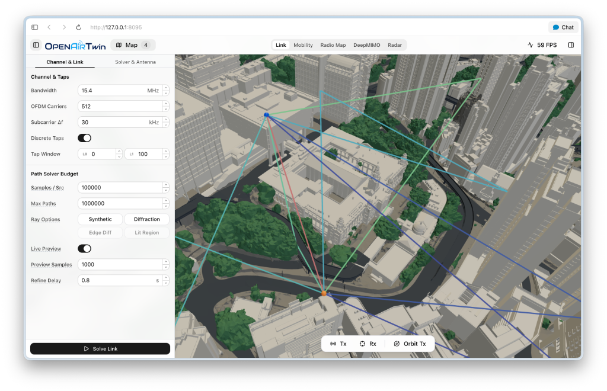
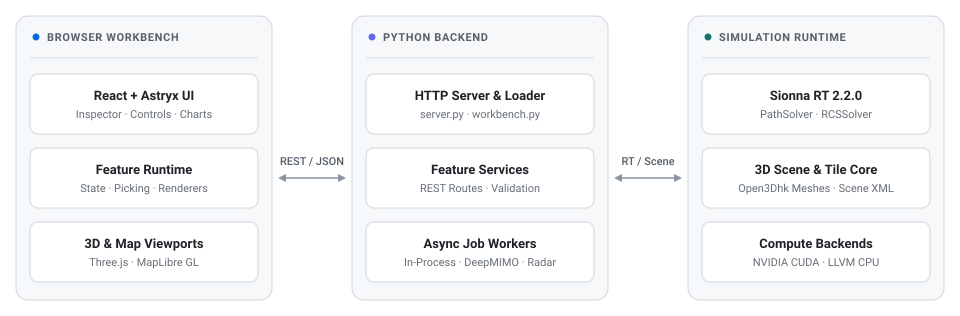

<div align="center">

<picture>
  <source media="(prefers-color-scheme: dark)" srcset="backend/static/assets/openairtwin_logo_dark.png">
  <source media="(prefers-color-scheme: light)" srcset="backend/static/assets/openairtwin_logo.png">
  
</picture>

<p><strong>Open-Source 3D Digital Twin Platform for Wireless Communication, Sensing, and AI Research</strong></p>

<p>
  <a href="LICENSE"></a>
  
  
  <a href="https://github.com/HKUOpenSource/OpenAirTwin/actions/workflows/ci.yml"></a>
</p>

<p>
  <a href="https://hkuopensource.github.io/OpenAirTwin/">Website</a> ·
  <a href="https://hkuopensource.github.io/OpenAirTwin/architecture/">Architecture</a> ·
  <a href="docs/development.md">Development</a> ·
  <a href="CONTRIBUTING.md">Contributing</a> ·
  <a href="LICENSE">License</a>
</p>

</div>

**OpenAirTwin** is an open-source 3D digital twin platform for physics-based wireless communication, sensing, and AI research. Built on **Sionna RT 2.2.0**, **Three.js**, and a **React** web workstation, it pairs real-world 3D city geometry with GPU- and CPU-accelerated ray tracing for propagation analysis, mobility, coverage mapping, DeepMIMO dataset generation, and OFDM radar sensing.

<p align="center">
  
</p>

## Features

- **3D City Digital Twin** — Load real-world 3D urban tiles on demand, including buildings, terrain, infrastructure, and vegetation, for site-specific ray tracing.
- **Link Analysis** — Compute 3D multipath propagation between configurable Tx/Rx antenna arrays, and inspect ray geometry, received power, CIR, and power delay profiles.
- **Mobility Simulation** — Evaluate time-varying multipath channels along 3D trajectories with synchronized per-step metrics and interactive path playback.
- **Radio Map** — Generate terrain-following coverage and path-gain heatmaps across dense urban scenes for blockage and deployment analysis.
- **DeepMIMO Dataset Export** — Export site-specific, ray-traced channel datasets over custom 3D regions of interest in standard DeepMIMO format for wireless AI research.
- **OFDM Radar Sensing** — Simulate monostatic and bistatic urban radar with moving 3D UAV targets, physical RCS and clutter modeling, range–Doppler processing, and CA-CFAR detection.

## Quick Start

### macOS / Linux

```bash
git clone https://github.com/HKUOpenSource/OpenAirTwin.git
cd OpenAirTwin
python3 install.py --with-sample-scene
set -a; . ./.oat-env; set +a
./.venv/bin/python -m backend.server
```

### Windows PowerShell

```powershell
git clone https://github.com/HKUOpenSource/OpenAirTwin.git
Set-Location OpenAirTwin
py -3.11 install.py --with-sample-scene
. .\.oat-env.ps1
.\.venv\Scripts\python.exe -m backend.server
```

Open **`http://127.0.0.1:8090`** in a desktop browser with WebGL2 support (recommended viewport `≥ 1280 × 720`). By default, the server binds to `127.0.0.1` without authentication; place it behind an authenticated reverse proxy before exposing it beyond localhost.

<a id="installation-details"></a>
<details>
<summary><strong>Requirements, CPU Setup, Installer Flags, and Troubleshooting</strong></summary>

- **Requirements:** Python `3.11+`, Chrome or Chromium with WebGL2 support (`≥ 1280 × 720`), and either an NVIDIA GPU for CUDA acceleration or LLVM for CPU-only execution.
- **CPU-only setup:** Install LLVM first, then pass `--cpu`:
  - **macOS:** `brew install llvm && python3 install.py --cpu --with-sample-scene`
  - **Ubuntu / Debian:** `sudo apt update && sudo apt install -y llvm && python3 install.py --cpu --with-sample-scene`
  - **Windows:** Install LLVM from [LLVM releases](https://releases.llvm.org/download.html), then run `py -3.11 install.py --cpu --with-sample-scene` in a new PowerShell window.
- **Installer flags (`python3 install.py --help`):** `--with-sample-scene` / `--no-sample-scene`, `--cpu`, `--gpu <index-or-uuid>`, `--yes`, `--doctor`, `--recreate-venv`, and `--dry-run`.
- **Troubleshooting:**
  - Run `python3 install.py --doctor` if CUDA or LLVM initialization fails.
  - Select and load at least one scene tile (`11_SW_7A-D`) in **Map** if solver controls appear disabled.
  - Source `.oat-env` (or `.oat-env.ps1` on Windows) before starting the server.

</details>

## Architecture

<p align="center">
  <picture>
    <source media="(prefers-color-scheme: dark)" srcset="backend/static/assets/openairtwin_architecture_dark.svg">
    <source media="(prefers-color-scheme: light)" srcset="backend/static/assets/openairtwin_architecture.svg">
    
  </picture>
</p>

Explore the full dependency graph, feature boundaries, and module layout in the **[Interactive Architecture Map](https://hkuopensource.github.io/OpenAirTwin/architecture/)** (source: [`docs/openairtwin-architecture.html`](docs/openairtwin-architecture.html)).

### Project Layout

```text
.
├── backend/       # Python HTTP server, Sionna RT 2.2.0 solvers, job managers, scene pipeline, and UI assets
├── workbench/     # React, TypeScript, and Astryx workstation UI source
├── website/       # Official landing page, interactive 3D Lab, and embedded architecture docs
├── docs/          # Architecture map, development guide, data notices, and UI contracts
├── tests/         # Python unit/integration suites and Playwright browser tests
├── tools/         # Scene build, local launch, and packaging utilities
└── install.py     # Cross-platform environment installer and diagnostics
```

## Configuration

The bundled sample scene includes four Open3Dhk tiles (`11_SW_7A`, `11_SW_7B`, `11_SW_7C`, and `11_SW_7D`). Override runtime settings via environment variables before launching the server:

```bash
OAT_HOST=127.0.0.1 OAT_PORT=8090 OAT_SCENE_ROOT=/path/to/scene ./.venv/bin/python -m backend.server
```

See [`backend/config.py`](backend/config.py) for all `OAT_*` options and validation bounds, and [`docs/data-licenses.md`](docs/data-licenses.md) for third-party spatial data and 3D UAV model licensing terms.

## Development

Standard usage requires only Python, as a prebuilt Workbench bundle is included. Contributors modifying the frontend UI or backend solvers can run:

```bash
npm --prefix workbench ci && npm --prefix workbench test
./.venv/bin/python -m pytest -q tests/
```

See [`CONTRIBUTING.md`](CONTRIBUTING.md) and [`docs/development.md`](docs/development.md) for contributor setup, UI conventions, and additional test suites.

## Citation

If OpenAirTwin supports your research, please cite:

> Wang, Z., Zhou, Z., &amp; Zhao, Z. (2026). OpenAirTwin (Version 1.2.0) [Computer software]. https://github.com/HKUOpenSource/OpenAirTwin/releases/tag/v1.2.0

```bibtex
@software{wang2026openairtwin,
  author  = {Wang, Zhaolin and Zhou, Zihao and Zhao, Zongyao},
  title   = {OpenAirTwin},
  version = {1.2.0},
  year    = {2026},
  url     = {https://github.com/HKUOpenSource/OpenAirTwin/releases/tag/v1.2.0},
  license = {Apache-2.0}
}
```

Machine-readable citation metadata is available in [`CITATION.cff`](CITATION.cff).

## License

OpenAirTwin is released under the **Apache License 2.0**. See [`LICENSE`](LICENSE) and [`THIRD_PARTY_NOTICES.md`](THIRD_PARTY_NOTICES.md) for software notices, and [`docs/data-licenses.md`](docs/data-licenses.md) for scene data and 3D model terms.
